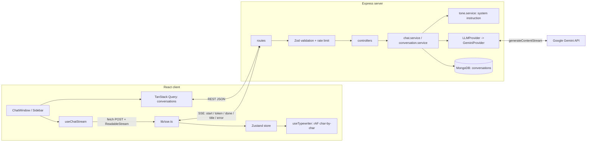

# ✨ Aura Chat: Real-time AI Chat Assistant (Google Gemini)

A full-stack AI chat app: **React + TypeScript** frontend, **Node.js + Express + TypeScript** backend, **MongoDB** persistence, and **Google Gemini** streaming responses shown character by character.

> Built for the *Vibe Coding: AI Chat Assistant* problem statement.


---

## ✅ Requirements checklist

| Requirement | Status | Where |
|---|---|---|
| Scrollable chat with distinct user / AI bubbles | ✅ | `client/src/components/chat/MessageBubble.tsx`, `MessageList.tsx` |
| Streaming view, character by character | ✅ | Server SSE `server/src/services/chat.service.ts` → client `useTypewriter.ts` |
| History sidebar of past threads | ✅ | `client/src/components/sidebar/*` (grouped Today / Yesterday / 7 days / Older) |
| AI API integration | ✅ Gemini via `@google/genai` | `server/src/services/llm/GeminiProvider.ts` (behind an `LLMProvider` interface, so OpenAI/Claude can be plugged in) |
| MongoDB persistence (timestamp, user prompt, AI response) | ✅ | `server/src/models/Conversation.ts` |
| **Tone Toggle** (Professional / Casual / Concise) → system instruction | ✅ | `server/src/services/tone.service.ts`, sent to Gemini as `config.systemInstruction` |
| **Extra 1:** Smart auto-titles + full-text search | ✅ | `title.service.ts`, MongoDB text index, sidebar search |
| **Extra 2:** Stop, Regenerate, Edit & Resend | ✅ | `chat.service.ts` (abort + replace exchange), `useChatStream.ts` |
| Business logic + validation on the server | ✅ | Zod schemas in `server/src/middleware/validate.ts`; titles, history, tone, errors are all server-side |

Also included: light/dark mode, responsive mobile drawer, Markdown + syntax highlighting + copy buttons, toasts with Retry, rate limiting, helmet, structured logging, graceful shutdown, keyboard shortcuts, tests.

---

## 🚀 Quick start

**Prerequisites:** Node.js 20+, a MongoDB database (Atlas or local), a Gemini API key.

```bash
# 1. Install everything (root + client + server workspaces)
npm install

# 2. Configure the server
#    Windows (PowerShell):  copy .env.example server\.env
#    macOS/Linux:           cp .env.example server/.env
#    then fill in MONGODB_URI, GEMINI_API_KEY, GEMINI_MODEL, GEMINI_FALLBACK_MODEL

# 3. Run client + server together
npm run dev
```

- Frontend: http://localhost:5173
- Backend: http://localhost:5000/api (health check: http://localhost:5000/api/health)

Other scripts: `npm test` (all tests), `npm run build` (production build), `npm run lint`.

The client uses `VITE_API_BASE_URL` (default `http://localhost:5000/api`). To change it, create `client/.env` with `VITE_API_BASE_URL=...`.

### Get a free Gemini API key
1. Go to **https://aistudio.google.com/app/apikey** and sign in.
2. Click **Create API key** and copy it into `GEMINI_API_KEY` in `server/.env`.
3. Set `GEMINI_MODEL` (e.g. a *Flash* model) and `GEMINI_FALLBACK_MODEL` (e.g. a *Flash-Lite* model).

### MongoDB Atlas setup
1. Create a free cluster at https://cloud.mongodb.com.
2. **Database Access** → add a user with a password.
3. **Network Access** → add your IP address (or `0.0.0.0/0` for testing). *If the server can't connect, this is usually the cause.*
4. **Connect → Drivers** → copy the `mongodb+srv://...` string into `MONGODB_URI` (URL-encode special characters in the password, e.g. `@` → `%40`).

**Local alternative:** `docker compose up -d`, then `MONGODB_URI=mongodb://localhost:27017/aura-chat`.

---

## 🏗️ Architecture



### How one message flows
1. The user types a message; the **current tone** is sent with it: `POST /api/conversations/:id/messages { prompt, tone }`.
2. **Zod** validates it on the server (prompt 1–8000 chars, tone enum). Chat routes are rate limited (10/min per IP).
3. `chat.service.ts` loads the conversation, takes the **last 6 successful exchanges** as context (roles `user`/`model`), and builds the system instruction = *base persona + tone modifier*.
4. `GeminiProvider` calls `ai.models.generateContentStream(...)` and forwards each chunk as an SSE `token` event.
5. The browser reads the stream with `fetch` + `ReadableStream` (EventSource only supports GET). Chunks go into a buffer; `useTypewriter` reveals them **character by character** with `requestAnimationFrame`, speeding up when the buffer grows.
6. When finished, the server saves the **exchange** (prompt, response, tone, timestamp, model, token usage, latency, status) and sends `done`. After the first exchange it generates a short **title** with the lighter model and sends `title`.
7. **Stop:** the client aborts the fetch → the server sees the socket close → aborts the Gemini call (saves quota) → saves the partial reply as `stopped`.

### Free-tier safeguards
- On **429 / RESOURCE_EXHAUSTED** (or 503 overloaded), the server retries **once** with `GEMINI_FALLBACK_MODEL`.
- If that also fails, the client gets `error { code: "RATE_LIMITED" }` and shows a toast with a countdown and **Retry**.
- Other errors map to `INVALID_API_KEY`, `MODEL_NOT_FOUND`, `NETWORK_ERROR`, `UNKNOWN` with friendly messages. Blocked/empty answers show a friendly message instead of an empty bubble.

### Folder structure
```
client/src
  components/chat      ChatWindow, MessageList, MessageBubble, Composer, StreamingText, Markdown, TypingIndicator
  components/sidebar   Sidebar, ThreadItem, SearchBar, NewChatButton
  components/controls  ToneToggle, ThemeToggle
  components/ui        Button, ConfirmDialog (Radix), Skeleton (shadcn-style)
  hooks                useChatStream, useTypewriter, useConversations
  lib                  api.ts, sse.ts, utils.ts
  store                chatStore.ts (Zustand)
server/src
  config               env.ts (Zod-validated env), db.ts
  models               Conversation.ts (exchanges sub-documents + indexes)
  routes               conversations.routes.ts, chat.routes.ts
  controllers          thin HTTP handlers
  services             chat, conversation, tone, title, llm/LLMProvider, llm/GeminiProvider
  middleware           validate (Zod), errorHandler, rateLimit
  utils                logger (pino), sse, mask, AppError
```

### Data model
```ts
Conversation {
  title: string                    // "New Chat" → auto-generated after the first exchange
  createdAt, updatedAt: Date
  exchanges: [{
    userPrompt, aiResponse: string
    tone: 'professional' | 'casual' | 'concise'
    timestamp: Date
    model: string                  // primary or fallback model actually used
    status: 'complete' | 'stopped' | 'error'
    usage: { inputTokens, outputTokens }
    latencyMs: number
  }]
}
// Indexes: { updatedAt: -1 } for the sidebar, text index on title + prompts + responses for search.
```

---

## 📡 API reference

| Method | Route | Purpose |
|---|---|---|
| GET | `/api/health` | DB status and configured model |
| GET | `/api/conversations?q=` | List threads (id, title, updatedAt, preview); `q` = full-text search with snippet |
| POST | `/api/conversations` | Create an empty thread |
| GET | `/api/conversations/:id` | Full thread with exchanges |
| PATCH | `/api/conversations/:id` | Rename `{ title }` |
| DELETE | `/api/conversations/:id` | Delete |
| POST | `/api/conversations/:id/messages` | **SSE stream**. Body `{ prompt, tone }` |
| POST | `/api/conversations/:id/exchanges/:exchangeId/regenerate` | **SSE stream**. Body `{ tone, prompt? }` (`prompt` = Edit & Resend) |

SSE events: `start {exchangeId}`, `token {text}`, `done {status, model, usage, latencyMs}`, `title {title}`, `error {code, message}`.
Errors (non-stream) always look like `{ "error": { "code": "...", "message": "..." } }`.

---

## ⌨️ Keyboard shortcuts
`Enter` send · `Shift+Enter` new line · `Esc` stop generation · `Ctrl/Cmd+K` search · `Ctrl/Cmd+Shift+O` new chat

## 🧪 Tests
`npm test` runs:
- **Server (Vitest + Supertest):** tone service, history → Gemini `contents` mapping, error classification, CRUD, streaming, validation, error events, regenerate/edit, search. The LLM is **mocked**, so tests never use Gemini quota. MongoDB comes from `mongodb-memory-server` (or `TEST_MONGODB_URI` if set).
- **Client (Vitest + React Testing Library):** typewriter hook, date grouping, SSE parsing.

## 🔐 Security
- The Gemini key lives only in `server/.env` (git-ignored) and is never sent to the browser. Startup logs mask secrets.
- `helmet`, CORS limited to `CLIENT_ORIGIN`, JSON body size limit, Zod validation, rate limiting, central error handler.

## 📈 Scaling to more users
- The API server is **stateless**, so you can run several instances behind a load balancer.
- `LLMProvider` lets you add OpenAI/Claude providers without touching routes.
- Next steps: user accounts (add `userId` to conversations + an auth middleware), a Redis store for rate limits, moving exchanges into their own collection for very long threads, and cursor pagination for the sidebar.

## ⚠️ Known limitations
- No user authentication: all conversations are shared by whoever runs the app.
- Rate-limit counters are kept in memory (per server instance).
- The sidebar loads up to 200 recent threads (no infinite scroll yet).
